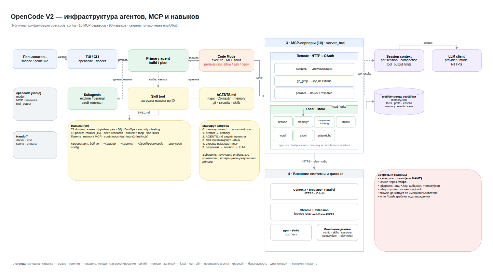

# opencode_config

Воспроизводимая конфигурация [OpenCode](https://opencode.ai) V2: 10 MCP-серверов, правила агента, наборы навыков, доступ к реальному Chrome и поиск с research-методологией.

Проверено на **OpenCode v2.2.6**, Ubuntu 24.04, Chrome (расширение browse 0.0.16), Node 22, Python 3.12 + `uv`.

---

## Что внутри

| Файл | Назначение |
|---|---|
| `opencode.jsonc` | Глобальный конфиг: модель, лимиты вывода, 10 MCP-серверов, таймауты |
| `AGENTS.md` | Глобальные правила агента: язык, Context7, память, стиль кода, git, безопасность |
| `install.sh` | Идемпотентный установщик: конфиг, правила, навыки, опционально browse и parallel-cli |
| `docs/mcp.md` | Каждый MCP-сервер: зачем, как добавить по отдельности, требования, отключение |
| `docs/skills.md` | Навыки: где лежат, как OpenCode их находит, установка, приоритеты |
| `docs/skills-manifest.md` | Автогенерируемый список всех 90 навыков с описаниями |
| `docs/browse.md` | Браузерный MCP: установка, pairing, модель безопасности |
| `docs/websearch.md` | Встроенный поиск, провайдеры, Parallel MCP и CLI |
| `docs/troubleshooting.md` | Реальные проблемы и их решения |
| `docs/architecture.drawio` | Схема инфраструктуры: агенты, MCP, навыки, память |
| `docs/architecture.md` | Пояснения к схеме и маршруту запроса |
| `docs/architecture.png` | PNG-превью схемы для README |
| `scripts/check-secrets.sh` | Проверка на ключи и абсолютные домашние пути |

---

## Архитектура



Схема показывает путь запроса, слой агентов, 10 MCP-серверов, 90 навыков и память между сессиями.
Редактируемая версия — [docs/architecture.drawio](docs/architecture.drawio), пояснения — [docs/architecture.md](docs/architecture.md).

---

## Требования

| Компонент | Зачем | Обязателен |
|---|---|---|
| OpenCode ≥ 2.2 | сам агент | да |
| Node.js ≥ 20 + `npx` | локальные MCP через `npx`, установщик навыков | да |
| `curl`, `git` | установка, клонирование | да |
| [`uv`](https://docs.astral.sh/uv/) (`uvx`) | MCP `word` и `excel` | для офисных документов |
| Google Chrome (или Chromium) | MCP `browse`, расширение browse | для браузера |
| `parallel-cli` | платный deep research | опционально |

---

## Быстрый старт

```sh
git clone https://github.com/Alexandor136/opencode_config-public.git
cd opencode_config

./install.sh --dry-run   # посмотреть план
./install.sh             # конфиг + правила + навыки
```

Полная установка, включая браузер и CLI для deep research:

```sh
./install.sh --all
```

После установки запустите `opencode` и проверьте статусы:

```sh
opencode mcp list
```

Ожидаемый результат — все серверы `connected`, кроме тех, что ждут OAuth-входа.

### Ручная установка

Если скриптам не доверяете, всё сводится к трём шагам:

```sh
# 1. конфиг и правила
mkdir -p ~/.config/opencode
sed "s|__HOME__|$HOME|g" opencode.jsonc > ~/.config/opencode/opencode.jsonc
cp AGENTS.md ~/.config/opencode/AGENTS.md

# 2. навыки (OpenCode читает ~/.agents/skills)
npx -y skills add parallel-web/parallel-agent-skills --all --global -y
npx -y skills add https://github.com/firecrawl/web-agent --skill deep-research -g -y

# 3. браузер (опционально)
curl -fsSL https://opencode.ai/browse/install | bash
```

`__HOME__` в `opencode.jsonc` — плейсхолдер: в нём пути к `browse` и файлу памяти. Подставляется при установке, чтобы конфиг не был привязан к конкретному пользователю.

---

## MCP-серверы

| Сервер | Тип | Что даёт | Требования |
|---|---|---|---|
| `browse` | local | Ваш реальный Chrome: логины, расширения, открытые вкладки | Chrome + расширение browse |
| `context7` | remote | Актуальная документация библиотек | — |
| `gh_grep` | remote | Реальные примеры кода из публичных репозиториев | — |
| `parallel` | remote | Веб-поиск, извлечение страниц, research, структурные источники | бесплатно без ключа; research — по подписке |
| `memory` | local | Долговременная память между сессиями | `npx` |
| `sequential-thinking` | local | Структурированные рассуждения для архитектуры и дебага | `npx` |
| `drawio` | local | Диаграммы draw.io | `npx` |
| `word` | local | Word-документы | `uvx` |
| `excel` | local | Excel-книги | `uvx` |
| `playwright` | local | Headless-браузер: E2E, скриншоты | `npx`, Chrome |

Подробности, команды `opencode mcp add` для каждого сервера и способы отключения — в [docs/mcp.md](docs/mcp.md).

---

## Навыки

OpenCode ищет навыки в нескольких местах (в порядке возрастания приоритета):

```
~/.claude/skills  →  ~/.agents/skills  →  ~/.config/opencode/skills  →  .opencode/skills
```

В этой конфигурации:

- **`~/.config/opencode/skills`** — 72 навыка предметной экспертизы (Python, Go, Rust, Angular, Django, Kubernetes, безопасность, тестирование и т.д.).
- **`~/.agents/skills`** — 18 навыков: пакет Parallel (15), `deep-research` от Firecrawl, плюс `context7-mcp` и `find-skills`.

`install.sh` ставит 16 из 18 автоматически. Два оставшихся (`context7-mcp`, `find-skills`) переносятся вручную — их исходные пакеты в репозитории не зафиксированы, см. [docs/skills-manifest.md](docs/skills-manifest.md).

Полный список с описаниями — в [docs/skills-manifest.md](docs/skills-manifest.md).

---

## Проверка работоспособности

```sh
opencode mcp list          # статусы серверов
npx -y skills ls -g        # список глобальных навыков
browse status              # браузер: relay, extension, сессии
parallel-cli --version     # CLI (если ставили)
```

Внутри сессии:

```text
проверь MCP parallel: сделай веб-поиск про OpenCode MCP servers
сделай deep research по <тема>      # платно, через parallel-cli
исследуй <тема>                      # бесплатно, через deep-research
```

---

## Безопасность

- В репозитории **нет** ключей, токенов и OAuth-креденшелов: только пути и URL. Секреты — через `{env:NAME}` или `/connect`.
- Проверка перед коммитом: `./scripts/check-secrets.sh` (ключи, приватные ключи, абсолютные домашние пути).
- `memory` MCP хранит долговременную память между сессиями в `~/.local/share/opencode/memory/memory.json`; файл исключён из git.
- `browse` даёт агенту доступ к вашему браузеру **от вашего имени**. Relay слушает `127.0.0.1:19988`; доступ есть у любого процесса вашего пользователя. Отвязать браузер: `browse pair --revoke <id>`.
- MCP-серверы запускаются с правами вашего пользователя. Добавляйте только те, которым доверяете.

---

## Кастомизация

| Что | Как |
|---|---|
| Модель по умолчанию | раскомментировать `"model"` в `opencode.jsonc` |
| Поиск встроенным `websearch` | `"websearch": { "provider": "random" }` — ротация при 429 |
| Прямой доступ к MCP-инструментам | `"codemode": false` у сервера (больше токенов в контексте) |
| Таймауты медленных серверов | `mcp.timeout` или `timeout` у конкретного сервера |
| Отключить сервер | `"disabled": true` |
| Свои навыки | `~/.config/opencode/skills/<id>/SKILL.md` |

---

## Ограничения

- `word` и `excel` не запустятся без `uvx`.
- `parallel` в бесплатном режиме имеет лимиты и иногда отдаёт шумные URL; после `parallel-cli login` выдача чище.
- `browse` требует запущенного Chrome: закрыли браузер — соединения нет.
- Deep research через Parallel — платная операция, тарифицируется на ваш аккаунт.

---

## Лицензия

Тексты и конфигурация этого репозитория — используйте свободно. Сторонние пакеты и навыки остаются под своими лицензиями.
